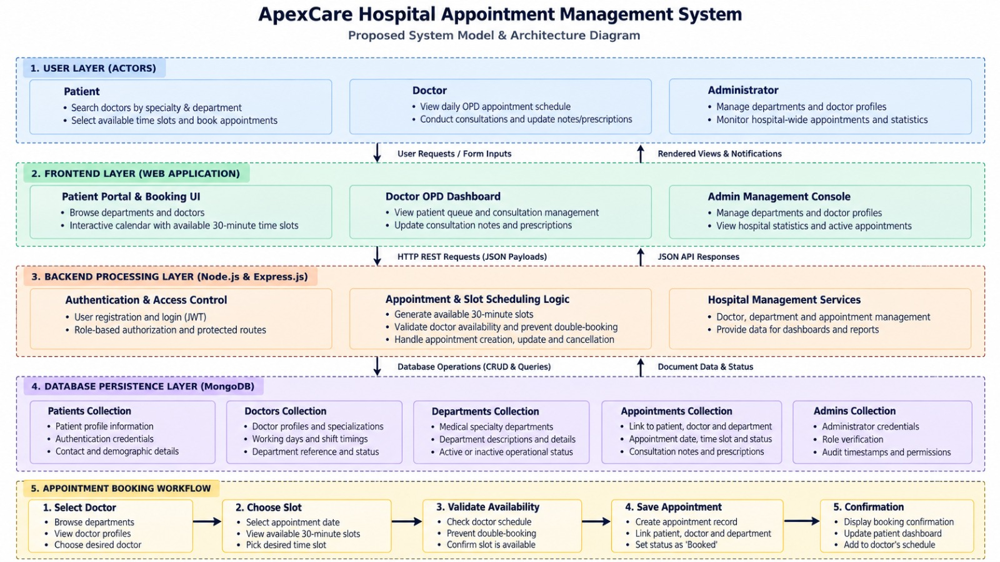

# ApexCare Hospital Appointment Management System

A web-based outpatient consultation and appointment scheduling platform developed with **Node.js**, **Express.js**, **MongoDB**, **Mongoose ODM**, and **vanilla HTML5/CSS3/JavaScript (ES6+)**.

Developed as an academic capstone project for the **Database Systems Lab (BCSE302P)** at the **School of Computer Science and Engineering, Vellore Institute of Technology (VIT), Vellore**, by **Ruthvik Reddy Thummala (24BAI0237)**.

---

## Table of Contents

1. [Project Overview](#project-overview)
2. [Key Features](#key-features)
3. [Technology Stack](#technology-stack)
4. [System Architecture](#system-architecture)
5. [Database Design](#database-design)
6. [Project Directory Structure](#project-directory-structure)
7. [Prerequisites](#prerequisites)
8. [Installation and Setup](#installation-and-setup)
9. [Local Development Demo Accounts](#local-development-demo-accounts)
10. [Application Workflow](#application-workflow)
11. [API Overview](#api-overview)
12. [Testing](#testing)
13. [Security and Data Handling](#security-and-data-handling)
14. [Limitations and Future Improvements](#limitations-and-future-improvements)
15. [Author and Academic Context](#author-and-academic-context)
16. [License](#license)

---

## Project Overview

Traditional hospital outpatient appointment scheduling often relies on manual paper registers, physical tokens, or uncoordinated telephone booking. These approaches introduce operational bottlenecks, extended patient waiting times, elevated risk of lost consultation records, and frequent physician double-booking.

The **ApexCare Hospital Appointment Management System** provides a centralized, digital outpatient scheduling platform. The system connects patients, medical specialists, and hospital administrators through dedicated web interfaces backed by RESTful APIs and a persistent MongoDB database.

Core capabilities include:
- A self-service portal for patients to search doctors by specialty, view consultation fees, and book 30-minute consultation slots.
- Real-time slot discretization calculating physician availability based on shift hours and existing bookings.
- An atomic compound partial unique index that eliminates double-booking at the database engine level.
- Outpatient queue management for physicians to record diagnostic examination notes and digital prescriptions.
- Administrative consoles for managing clinical departments, doctor credentials, and non-destructive deactivation/reactivation lifecycles.

---

## Key Features

### Authentication and Authorization
- **Universal Multi-Role Sign-In:** Dedicated authentication tabs for Patients, Doctors, and Administrators on a unified login portal.
- **Patient Self-Registration:** Form capturing full name, email, phone, gender, date of birth, blood group, and residential address.
- **Cryptographic Password Security:** Passwords salted and hashed using `bcryptjs` before storage; raw credentials are never persisted.
- **Session Management:** Stateless JSON Web Tokens (JWT) transmitted via HTTP-only cookies and Bearer authorization headers.
- **Role-Based Access Control (RBAC):** Express middleware (`protect`, `authorize`) restricting route access by role.

### Patient Features
- **Specialist Directory:** Browse physicians filtered by medical specialty, department, consultation fee, and availability.
- **Dynamic Slot Matrix:** Select appointment dates and pick from available 30-minute consultation intervals.
- **Self-Booking Security:** Patient ID is bound to the authenticated JWT session token (`req.user.id`), preventing impersonation.
- **Appointment Management:** Review upcoming and past appointments with doctor details, consultation fees, and timestamps.
- **Self-Service Rescheduling & Cancellation:** Reschedule active bookings to new available slots or cancel appointments to release slots immediately.
- **Personal Profile Management:** View registered demographics and update contact numbers, blood group, and residential address.

### Doctor Features
- **Physician Profile & Shift Configuration:** View department assignment, qualifications, experience years, consultation fees, working days, and operating hours.
- **Live Outpatient Queue:** Filter assigned appointments by status (`Booked`, `Completed`, `Cancelled`) and consultation date.
- **Clinical Consultation Completion:** Interactive dialog to document clinical examination notes and digital prescriptions.
- **Historical Consultation Records:** Retain past patient consultation notes and prescriptions.

### Administrator Features
- **Executive Metrics Dashboard:** Aggregated metrics showing total registered patients, active doctors, active departments, and daily appointment counts.
- **Department Management:** Create new clinical departments, update descriptions and icons, and review doctor staffing counts.
- **Department Status Lifecycle:** Deactivate clinical departments to pause bookings while preserving historical records; reactivate at any time.
- **Doctor Provisioning & Roster:** Create physician accounts, configure operating shifts and slot durations, and assign clinical departments.
- **Doctor Status Lifecycle:** Deactivate doctor availability to block new appointments while retaining past consultations; reactivate instantly.
- **Master Appointment Audit Register:** Hospital-wide register displaying patient names, assigned doctors, departments, dates, times, and lifecycle statuses.

### Database and Reliability
- **Document-Oriented Storage:** Normalized BSON document collections in MongoDB with strict Mongoose schema validation.
- **Relational Integrity via ObjectIds:** Relational links connecting appointments to patients, doctors, and departments.
- **Zero Double-Booking Engine:** Database-level compound partial unique index guaranteeing slot uniqueness for active bookings.
- **Resilient Database Connection:** Automatic reconnection handling with configurable timeouts (`serverSelectionTimeoutMS`).
- **Centralized Error Handling:** Standardized JSON error responses for validation failures, authentication errors, and database conflicts.

---

## Technology Stack

| Technology | Purpose |
| :--- | :--- |
| **HTML5** | Provides semantic page structure across all public and dashboard views. |
| **CSS3** | Handles responsive interface styling, custom layout systems, modals, and status badges. |
| **JavaScript (ES6+)** | Drives client-side UI logic, dynamic DOM updates, and asynchronous `fetch` API requests. |
| **Node.js** | Serves as the cross-platform asynchronous server-side JavaScript runtime environment. |
| **Express.js (v5.3)** | Manages HTTP routing, RESTful API endpoints, request parsing, and security middleware. |
| **MongoDB** | Stores persistent application data in schemaless, scalable BSON document collections. |
| **Mongoose ODM (v9.1)** | Enforces schema definitions, type validation, model relationships, and compound indexes. |
| **JSON Web Tokens (JWT)** | Manages cryptographically signed, stateless authentication tokens for user sessions. |
| **bcryptjs** | Performs one-way salted password hashing to secure stored credentials. |
| **express-rate-limit** | Mitigates brute-force authentication attacks on sensitive registration and login endpoints. |
| **cookie-parser** | Parses cookie headers to extract and validate HTTP-only JWT session cookies. |
| **cors** | Configures Cross-Origin Resource Sharing headers for authorized client requests. |
| **dotenv** | Loads environment variables from a local `.env` file into `process.env`. |

---

## System Architecture

The application follows a decoupled multi-tier architecture where the presentation layer, application server, business logic services, and database engine communicate asynchronously:

1. **User Interaction:** The user interacts with the responsive browser interface (`public/`).
2. **Asynchronous Request:** Client-side JavaScript makes an asynchronous `fetch` call to the Express REST API, attaching JWT session credentials via HTTP-only cookies or Authorization headers.
3. **Routing & Middleware Pipeline:** Express routes incoming HTTP requests through security middleware:
   - `cors` verifies request origins.
   - `express-rate-limit` enforces rate limits on authentication routes.
   - `cookieParser` extracts session tokens.
   - `protect` verifies and decodes the JWT token.
   - `authorize` checks whether the authenticated user role matches required permissions.
4. **Controllers & Business Logic:** The controller validates input payloads, checks business rules, invokes `slotService` for dynamic slot calculations, and calls Mongoose models.
5. **Mongoose ODM Layer:** Mongoose validates data types, checks required constraints, and executes queries against MongoDB.
6. **MongoDB Storage Engine:** MongoDB executes reads or atomic writes, enforcing collection-level unique and partial unique index constraints.
7. **Response & UI Update:** The API returns a standardized JSON response (`status`, `data`, or `message`). Client-side JavaScript updates the DOM without requiring a full page reload.

### Architecture Diagram

The high-level architecture diagram is available in the repository at:

```text
docs/diagrams/architecture_diagram.jpeg
```



---

## Database Design

The system uses MongoDB as its primary datastore. The active database name is determined by the connection string specified in `MONGODB_URI` (defaults to `hospital_management` in `.env.example`).

### Core Collections

1. **`patients`** (`src/models/Patient.js`):
   - Stores registered patient records.
   - Key attributes: `name`, `email` (unique, lowercased), `passwordHash`, `phone`, `dateOfBirth`, `gender`, `bloodGroup`, `address`, `createdAt`, `updatedAt`.
2. **`doctors`** (`src/models/Doctor.js`):
   - Stores physician profiles and operating schedules.
   - Key attributes: `departmentId` (`ObjectId` reference to `Department`), `name`, `email` (unique, lowercased), `passwordHash`, `phone`, `specialization`, `qualifications` (`[String]`), `experienceYears`, `consultationFee`, `bio`, `profileImage`, `availability` (`'active'` or `'inactive'`), `workingDays` (`[String]`), `workingHours` (`{ start, end }`), `slotDurationMinutes` (default: 30), timestamps.
3. **`departments`** (`src/models/Department.js`):
   - Stores clinical specialties.
   - Key attributes: `departmentName` (unique, required), `description`, `icon`, `isActive` (Boolean toggle), timestamps.
4. **`appointments`** (`src/models/Appointment.js`):
   - Functions as the operational relational junction connecting patients, doctors, and departments.
   - Key attributes: `patientId` (`ObjectId` &rarr; `Patient`), `doctorId` (`ObjectId` &rarr; `Doctor`), `departmentId` (`ObjectId` &rarr; `Department`), `appointmentDate` (`Date`), `appointmentDateString` (`YYYY-MM-DD`), `appointmentTime` (`HH:mm`), `reason`, `status` (`['Booked', 'Completed', 'Cancelled']`), `notes`, `prescription`, timestamps.
5. **`admins`** (`src/models/Admin.js`):
   - Stores platform administrator accounts.
   - Key attributes: `name`, `email` (unique, lowercased), `passwordHash`, `role` (default: `'admin'`), timestamps.

### Relational Schema Mappings

- **Department &rarr; Doctors (1:N):** One department contains multiple doctors. Each doctor document stores `departmentId` referencing its parent department.
- **Patient &rarr; Appointments (1:N):** One patient can hold multiple appointment bookings. Each appointment document stores `patientId`.
- **Doctor &rarr; Appointments (1:N):** One doctor can conduct multiple appointments. Each appointment document stores `doctorId`.
- **Department &rarr; Appointments (1:N):** Each appointment records the clinical `departmentId` associated with the consultation.
- **Admin Governance:** Administrators do not have a foreign key on appointments; they oversee the platform through role-based access middleware.

### Concurrency Control & Partial Unique Index

To eliminate appointment scheduling race conditions and guarantee zero double-booking at the storage engine level, the `Appointment` model implements a compound partial unique index:

```javascript
appointmentSchema.index(
  { doctorId: 1, appointmentDateString: 1, appointmentTime: 1 },
  {
    unique: true,
    partialFilterExpression: { status: 'Booked' },
    name: 'unique_active_doctor_slot'
  }
);
```

- **Conflict Prevention:** If two concurrent requests attempt to insert an active booking for the same physician at the exact same date and time, MongoDB atomically permits only the first insert and rejects the second with Error Code 11000.
- **Slot Reusability:** Because the unique constraint applies exclusively when `status` is `'Booked'`, cancelling an appointment updates its status to `'Cancelled'`, which automatically excludes the document from the partial index. The time slot immediately becomes available for other patients without database modification conflicts.

### Entity-Relationship (ER) Diagram

The complete Entity-Relationship diagram is retained in the repository at:

```text
docs/diagrams/er_diagram.png
```


*(A scalable vector version is also available at `docs/diagrams/er_diagram.svg`).*

---

## Project Directory Structure

```text
Hospital-AppointmentManagementSystem/
├── .env.example              # Sample environment template with safe placeholder defaults
├── .gitignore                # Comprehensive Git exclusion rules
├── LICENSE                   # MIT License
├── package.json              # Project dependencies, scripts, and engine specifications
├── package-lock.json         # Exact deterministic dependency lockfile for npm ci
├── README.md                 # Primary project documentation and developer guide
├── server.js                 # Express application entry point, route mounts & error handling
│
├── public/                   # Client-side presentation tier (HTML, CSS, JavaScript)
│   ├── css/
│   │   ├── main.css          # Healthcare UI design tokens, navigation, modals, toasts
│   │   └── dashboard.css     # Sidebar layouts, metric widgets, slot matrix styling
│   ├── js/
│   │   ├── api.js            # Centralized API fetch wrapper and token manager
│   │   ├── auth.js           # Client session verification and route guards
│   │   ├── landing.js        # Dynamic department and physician directory logic
│   │   ├── patient-dashboard.js # Booking, rescheduling, cancellation, and history logic
│   │   ├── doctor-dashboard.js  # Live OPD consultation queue and prescription logic
│   │   └── admin-dashboard.js   # Department and doctor lifecycle management logic
│   ├── index.html            # Public landing page with specialist directory
│   ├── login.html            # Universal sign-in portal with role selector tabs
│   ├── register.html         # Patient registration form with demographic validation
│   ├── book-appointment.html # 4-step dynamic clinical appointment scheduler
│   ├── patient-dashboard.html# Patient dashboard for appointment tracking and history
│   ├── doctor-dashboard.html # Doctor OPD dashboard for consultation completion
│   └── admin-dashboard.html  # Administrator console for system oversight and audits
│
├── src/                      # Server-side application architecture (MVC)
│   ├── config/
│   │   └── db.js             # Mongoose connection manager and database health monitor
│   ├── controllers/
│   │   ├── authController.js       # Register, login, session retrieval, and logout
│   │   ├── departmentController.js # Department CRUD, doctor count aggregation, status
│   │   ├── doctorController.js     # Specialist search, slot calculation, availability
│   │   ├── patientController.js    # Patient profile updates and record management
│   │   ├── appointmentController.js# Concurrency booking, reschedule, cancel, complete
│   │   └── adminController.js      # Executive aggregations and master audit register
│   ├── middleware/
│   │   ├── auth.js           # JWT authentication and role-based authorization guards
│   │   ├── errorHandler.js   # Centralized error handler and 404 route catcher
│   │   └── rateLimiter.js    # Rate limiter for authentication endpoints
│   ├── models/
│   │   ├── Patient.js        # Patient schema with bcrypt password hashing
│   │   ├── Doctor.js         # Doctor schema with qualifications, shift hours, fees
│   │   ├── Department.js     # Clinical department schema with active toggle
│   │   ├── Appointment.js    # Appointment schema with compound partial unique index
│   │   └── Admin.js          # Platform administrator schema
│   ├── routes/
│   │   ├── authRoutes.js           # Authentication endpoints (/api/auth)
│   │   ├── departmentRoutes.js     # Department management endpoints (/api/departments)
│   │   ├── doctorRoutes.js         # Doctor endpoints (/api/doctors)
│   │   ├── patientRoutes.js        # Patient endpoints (/api/patients)
│   │   ├── appointmentRoutes.js    # Appointment transaction endpoints (/api/appointments)
│   │   └── adminRoutes.js          # Administrator endpoints (/api/admin)
│   ├── services/
│   │   └── slotService.js    # Mathematical 30-min slot discretization engine
│   └── utils/
│       ├── helpers.js        # Date/time formatters, regex validation, sanitization
│       └── seed.js           # Database seeding script with sample clinical data
│
├── tests/                    # Automated testing suite
│   ├── run-tests.js          # 24-scenario automated regression test runner
│   └── run-tests.ps1         # PowerShell test execution shortcut script
│
├── scripts/                  # Operations & maintenance utilities
│   └── backup-db.js          # JSON collection snapshot export utility
│
└── docs/                     # Technical documentation & architecture diagrams
    ├── MONGODB_GUIDE.md      # MongoDB reference guide
    ├── MONGODB_QUERY_REFERENCE.md # Aggregation pipeline reference
    └── diagrams/
        ├── architecture_diagram.jpeg # Multi-tier architecture diagram
        ├── er_diagram.png            # Entity-Relationship diagram (High-Resolution)
        ├── er_diagram.svg            # Entity-Relationship diagram (Vector SVG)
        └── proposed_model_diagram.svg# Process and data flow model
```

---

## Prerequisites

Before running the application, ensure the following are installed:

- **Node.js:** `v18.0.0` or higher (verified on Node.js v24.x). Check with:
  ```bash
  node -v
  ```
- **npm:** `v9.0.0` or higher (bundled with Node.js). Check with:
  ```bash
  npm -v
  ```
- **MongoDB:** A running MongoDB instance (version 6.0 or higher):
  - **Option A (Local):** MongoDB Community Server running locally on default port `27017` (`mongodb://127.0.0.1:27017`).
  - **Option B (Cloud):** A free [MongoDB Atlas](https://www.mongodb.com/cloud/atlas) cluster with network access enabled.
- **Git:** Installed on your system to clone the repository. Check with:
  ```bash
  git --version
  ```

---

## Installation and Setup

Follow these step-by-step instructions to set up the project locally from scratch.

### 1. Clone the Repository

Clone the project from GitHub into your local workspace:

```bash
git clone <YOUR_GITHUB_REPOSITORY_URL>
cd Hospital-Appointment-ManagementSystem
```

*(Replace `<YOUR_GITHUB_REPOSITORY_URL>` with your actual repository URL).*

### 2. Install Dependencies

Install the project dependencies using `npm ci` for a clean, deterministic installation matching `package-lock.json`:

```bash
npm ci
```

*(Alternatively, run `npm install` if you intend to add or modify dependencies).*

### 3. Configure Environment Variables

Create your local `.env` configuration file by copying the provided `.env.example` template:

```bash
# On Linux / macOS / Git Bash:
cp .env.example .env

# On Windows PowerShell:
copy .env.example .env
```

Open `.env` in an editor and configure the variables:

```ini
# Server Network Port
PORT=5000

# Node Environment Mode
NODE_ENV=development

# MongoDB Connection String
# For Local MongoDB (Default):
MONGODB_URI=mongodb://127.0.0.1:27017/hospital_management
# For MongoDB Atlas:
# MONGODB_URI=mongodb+srv://<username>:<password>@cluster0.xxxxx.mongodb.net/hospital_management?retryWrites=true&w=majority

# Secret for signing JWT authentication tokens (use a strong random string in production)
JWT_SECRET=super_secret_hospital_management_jwt_key_2026_vit_dbms

# JWT Token Expiry Duration
JWT_EXPIRES_IN=24h

# Development Seed Administrator Credentials (used during 'npm run seed')
SEED_ADMIN_NAME=Super Administrator
SEED_ADMIN_EMAIL=admin@hospital.com
SEED_ADMIN_PASSWORD=Admin@123456
```

> [!IMPORTANT]
> - Never commit your `.env` file to version control. The `.gitignore` file is configured to exclude `.env` automatically.
> - For production deployments, replace `JWT_SECRET` with a secure 64-character random string and ensure `MONGODB_URI` uses authenticated connection credentials.

### 4. Seed the Database

Populate the database with sample clinical departments, fictional doctors, registered patients, and initial appointment records:

```bash
npm run seed
```

This command creates records only if they do not already exist, preserving any existing data.

> [!CAUTION]
> If you want to wipe all collections and perform a clean re-seed, run:
> ```bash
> npm run seed:reset
> ```
> This command will permanently delete all existing appointments, patients, doctors, departments, and administrators in `hospital_management`. Use with caution.

### 5. Start the Application

Start the Express application server:

```bash
npm start
```

For development mode with automatic server reloading:

```bash
npm run dev
```

Upon successful startup, the console displays:

```text
======================================================
 Hospital Appointment Management System is Running!
 Local Server: http://localhost:5000
 Database:     MongoDB (Checked via Mongoose)
 Environment:  development
======================================================
```

### 6. Open the Application

Open your browser and navigate to:

```text
http://localhost:5000/
```

- Public Landing Page: `http://localhost:5000/`
- Universal Sign-In Portal: `http://localhost:5000/login` (or `/login.html`)
- Patient Registration: `http://localhost:5000/register` (or `/register.html`)
- Appointment Booking: `http://localhost:5000/book-appointment` (or `/book-appointment.html`)

---

## Local Development Demo Accounts

When the database is seeded using `npm run seed`, the following development accounts are available for testing:

| Role | Email Address | Password | Permissions & Dashboard Scope |
| :--- | :--- | :--- | :--- |
| **Administrator** | `admin@hospital.com` | `Admin@123456` | Hospital-wide metrics, doctor/department provisioning, status toggles, master audit register |
| **Doctor (Cardiology)** | `dr.rajesh@hospital.com` | `Doctor@123456` | Assigned OPD queue, consultation completion, diagnostic notes, digital prescriptions |
| **Doctor (Dermatology)** | `dr.ananya@hospital.com` | `Doctor@123456` | Specialist outpatient queue and consultation records |
| **Doctor (Orthopedics)** | `dr.vikram@hospital.com` | `Doctor@123456` | Specialist outpatient queue and consultation records |
| **Doctor (Pediatrics)** | `dr.priya@hospital.com` | `Doctor@123456` | Specialist outpatient queue and consultation records |
| **Doctor (General Medicine)** | `dr.rohan@hospital.com` | `Doctor@123456` | Primary care outpatient queue and consultation records |
| **Patient 1** | `rahul.verma@example.com` | `Patient@123456` | Appointment booking, rescheduling, cancellation, personal medical history |
| **Patient 2** | `anita.desai@example.com` | `Patient@123456` | Appointment booking, rescheduling, personal medical history |

> [!NOTE]
> The login portal (`/login.html`) includes role-selector tabs corresponding to these credentials. These accounts are intended strictly for local development, academic demonstration, and testing.

---

## Application Workflow

### 1. Patient Workflow
1. **Registration / Login:** The patient registers at `/register.html` or signs in through the Patient tab at `/login.html`. Upon successful login, a JWT cookie is stored.
2. **Search Doctors:** The patient navigates to `/book-appointment.html` and browses specialists by clinical department.
3. **Select Date & Available Slot:** The patient selects an appointment date. The frontend calls `/api/doctors/:id/slots?date=YYYY-MM-DD`. The backend `slotService` discretizes the physician's operating hours into 30-minute intervals, filters out past times and existing bookings, and returns available slots.
4. **Submit Booking:** The patient selects a slot, enters a visit reason, and submits the booking. The backend verifies that `req.user.role === 'patient'` and binds `patientId = req.user.id`. The appointment is inserted with `status: 'Booked'`.
5. **Manage Visits:** On `/patient-dashboard.html`, the patient views upcoming visits, downloads prescription details, reschedules active appointments to another slot, or cancels visits to release the slot.

### 2. Doctor Workflow
1. **Login:** The physician signs in through the Doctor tab on `/login.html`.
2. **Review OPD Queue:** The doctor dashboard (`/doctor-dashboard.html`) displays assigned outpatient appointments, with status filtering (`All`, `Booked`, `Completed`, `Cancelled`) and date indicators.
3. **Complete Consultation:** For active visits, the doctor clicks **Complete Consultation**, opens the clinical modal, enters diagnostic examination notes and prescriptions, and submits.
4. **Update Status:** The backend updates `status: 'Completed'`, records timestamps, and permanently links the notes to the appointment document.

### 3. Administrator Workflow
1. **Login:** The administrator signs in through the Administrator tab on `/login.html`.
2. **Review Hospital Metrics:** The admin console (`/admin-dashboard.html`) displays aggregate counts (total patients, active doctors, active departments, today's appointments) retrieved via MongoDB aggregation.
3. **Manage Departments:** Create new departments or toggle operational status (Deactivate / Reactivate). Deactivating a department prevents new bookings while preserving all existing appointments.
4. **Manage Doctors:** Add new doctors, configure working hours and consultation fees, or toggle doctor availability. Deactivated doctors are immediately excluded from patient booking slot queries.
5. **Inspect Master Audit Register:** Review the hospital-wide appointments register with multi-criteria search and status filtering.

---

## API Overview

All API endpoints are prefixed with `/api`. Protected routes require a valid JWT token transmitted via an HTTP-only cookie or as a `Bearer <token>` header in the `Authorization` header.

### Authentication Endpoints (`/api/auth`)

| Method | Endpoint | Purpose | Access Control |
| :--- | :--- | :--- | :--- |
| `POST` | `/api/auth/register` | Register a new patient account | Public (Rate Limited) |
| `POST` | `/api/auth/login` | Universal login for Patients, Doctors, Admins | Public (Rate Limited) |
| `POST` | `/api/auth/logout` | Clear session cookie and invalidate auth | Public |
| `GET` | `/api/auth/me` | Retrieve profile of the currently logged-in user | Authenticated |

### Department Endpoints (`/api/departments`)

| Method | Endpoint | Purpose | Access Control |
| :--- | :--- | :--- | :--- |
| `GET` | `/api/departments` | List all active clinical departments with doctor counts | Public |
| `GET` | `/api/departments/:id` | Get specific department details | Public |
| `POST` | `/api/departments` | Create a new clinical specialty department | Administrator |
| `PUT` | `/api/departments/:id` | Update department name, description, or icon | Administrator |
| `PATCH` | `/api/departments/:id/toggle-status` | Toggle department operational status (Active / Inactive) | Administrator |
| `DELETE` | `/api/departments/:id` | Remove department (blocked if doctors are assigned) | Administrator |

### Doctor Endpoints (`/api/doctors`)

| Method | Endpoint | Purpose | Access Control |
| :--- | :--- | :--- | :--- |
| `GET` | `/api/doctors` | Query doctors (supports `departmentId`, `search`, `all`) | Public / Optional Auth |
| `GET` | `/api/doctors/:id` | Retrieve comprehensive doctor profile | Public |
| `GET` | `/api/doctors/:id/slots` | Compute available 30-min slots for a given date | Public |
| `GET` | `/api/doctors/:id/stats` | Retrieve doctor consultation metrics & queue stats | Doctor, Administrator |
| `PUT` | `/api/doctors/:id` | Update doctor profile or operating schedule | Doctor, Administrator |
| `POST` | `/api/doctors` | Provision and create a new doctor account | Administrator |
| `PATCH` | `/api/doctors/:id/toggle-status` | Toggle doctor availability (`active` / `inactive`) | Administrator |

### Patient Endpoints (`/api/patients`)

| Method | Endpoint | Purpose | Access Control |
| :--- | :--- | :--- | :--- |
| `GET` | `/api/patients/dashboard-stats` | Summary of patient visit history and upcoming counts | Patient |
| `GET` | `/api/patients/profile` | Retrieve authenticated patient personal profile | Patient, Administrator |
| `PUT` | `/api/patients/profile` | Update phone, blood group, or residential address | Patient |
| `GET` | `/api/patients` | List all registered patients with search & pagination | Administrator |
| `GET` | `/api/patients/:id` | Inspect patient details and visit records | Administrator |

### Appointment Endpoints (`/api/appointments`)

| Method | Endpoint | Purpose | Access Control |
| :--- | :--- | :--- | :--- |
| `POST` | `/api/appointments` | Book appointment (patientId derived from `req.user.id`) | Patient Only |
| `GET` | `/api/appointments` | List appointments (role-scoped query) | Authenticated |
| `GET` | `/api/appointments/:id` | View specific appointment details | Authenticated (Participant / Admin) |
| `PUT` | `/api/appointments/:id/reschedule` | Reschedule an active appointment to a new slot | Authenticated (Participant / Admin) |
| `PATCH` | `/api/appointments/:id/cancel` | Cancel an active appointment and release the slot | Authenticated (Participant / Admin) |
| `PATCH` | `/api/appointments/:id/complete` | Complete consultation with diagnosis notes and prescription | Doctor, Administrator |

### Administration & Health Endpoints

| Method | Endpoint | Purpose | Access Control |
| :--- | :--- | :--- | :--- |
| `GET` | `/api/admin/dashboard-stats` | Hospital-wide aggregation metrics & analytics | Administrator |
| `GET` | `/api/admin/list` | List all platform administrator accounts | Administrator |
| `POST` | `/api/admin/create` | Provision a new administrator account | Administrator |
| `GET` | `/api/health` | System status, timestamp, environment, database health | Public |

---

## Testing

The project includes an automated integration test suite located at `tests/run-tests.js`.

### Test Architecture & Safety Isolation
- **Isolated Test Database:** The test runner connects to `hospital_test_db` (configured via `TEST_MONGODB_URI` or `mongodb://127.0.0.1:27017/hospital_test_db`). It **never** modifies or deletes documents in your primary `hospital_management` database.
- **Dynamic Port Selection:** The test server starts on an ephemeral port (`process.env.PORT = '5001'`), preventing port conflicts with running production or development instances.

### Running the Tests

Execute the automated test suite using npm:

```bash
npm test
```

*(On Windows PowerShell, you can also run `.\tests\run-tests.ps1`).*

### Verified Test Scenarios

The suite executes 24 automated integration scenarios covering authentication, access control, slot generation, concurrency protection, and lifecycle operations:

```text
===========================================================
 AUTOMATED TEST RESULTS SUMMARY
===========================================================
 [PASS]  Test 1: Successful patient registration (HTTP 201)
 [PASS]  Test 2: Duplicate email rejection (HTTP 409)
 [PASS]  Test 3: Password hashing verification (Bcrypt salt & hash verified)
 [PASS]  Test 4: Successful login (HTTP 200)
 [PASS]  Test 5: Invalid login rejection (HTTP 401)
 [PASS]  Test 6: Unauthenticated access rejection (HTTP 401)
 [PASS]  Test 7: Unauthorized role access rejection (HTTP 403)
 [PASS]  Test 8: Successful department creation (HTTP 201)
 [PASS]  Test 9: Doctor filtering by department and specialization
 [PASS]  Test 10: Successful appointment booking (HTTP 201)
 [PASS]  Test 11: Double-booking conflict rejection (HTTP 409 conflict caught)
 [PASS]  Test 12: Past-date appointment rejection (HTTP 400 rejected)
 [PASS]  Test 13: Successful appointment rescheduling
 [PASS]  Test 14: Conflicting rescheduling rejection (HTTP 409 conflict caught)
 [PASS]  Test 15: Appointment cancellation (Slot released)
 [PASS]  Test 16: Appointment history retention (Document persisted with audit trace)
 [PASS]  Test 17: Appointment status transition validation (Redundant cancel rejected)
 [PASS]  Test 18: Patient cross-access restriction (HTTP 403 denied)
 [PASS]  Test 19: Doctor cross-access restriction (HTTP 403 forbidden)
 [PASS]  Test 20: Admin dashboard aggregation results ($lookup join verified)
 [PASS]  Test 21: Doctor dashboard stats aggregation (ObjectId verification)
 [PASS]  Test 22: Doctor deactivation and reactivation lifecycle
 [PASS]  Test 23: Patient-only self-booking & Admin booking restriction
 [PASS]  Test 24: Department deactivation and reactivation lifecycle
===========================================================
 Total: 24 | Passed: 24 | Failed: 0 | Success Rate: 100.0%
===========================================================
```

---

## Security and Data Handling

The system implements multiple defensive security practices verified in the application code:

1. **Password Hashing:** Passwords are hashed using `bcryptjs` with 10 salt rounds before storage. Plaintext passwords are never logged or stored.
2. **Stateless JWT Sessions:** JSON Web Tokens are signed using HMAC-SHA256 with a private `JWT_SECRET`. Tokens are transmitted via HTTP-only cookies (`httpOnly: true`, `sameSite: 'strict'`) and Bearer Authorization headers to mitigate Cross-Site Scripting (XSS) risks.
3. **Role-Based Route Guards:** Middleware functions `protect` and `authorize` strictly enforce that only authorized roles can invoke administrative, clinical, or patient endpoints.
4. **Patient-Only Booking Authorization:** The appointment booking controller enforces `req.user.role === 'patient'` and assigns `patientId = req.user.id`, ignoring any spoofed `patientId` fields passed in request bodies.
5. **Rate Limiting:** Express rate limiting (`express-rate-limit`) restricts requests to `/api/auth/login` and `/api/auth/register` (maximum 10 requests per 15 minutes per IP), mitigating brute-force credential stuffing.
6. **NoSQL Injection Resistance:** Mongoose schema definitions enforce strict typing and sanitize query criteria against raw operator injection.
7. **Database-Level Concurrency:** The compound partial unique index prevents appointment double-booking race conditions directly at the storage engine level.

### Deployment & Safety Guidelines
- **Keep `.env` Private:** Never commit real API keys, passwords, or production connection strings to version control.
- **Production Secrets:** In production environments, generate a 64-character random string for `JWT_SECRET` and enable TLS/HTTPS (`secure: true` on cookies).
- **Synthetic Data:** The demo seed data contains only synthetic records. Never populate production environments with unencrypted patient healthcare records.
- **Academic Scope Notice:** This software is an academic engineering prototype developed for demonstration and coursework evaluation. It is not certified for clinical diagnostic use or regulatory compliance (e.g., HIPAA).

---

## Limitations and Future Improvements

### Current Limitations
- **Academic Prototype:** Designed as an educational prototype for database systems lab evaluation rather than a live clinical system.
- **Manual Communication:** Notifications (e.g., booking confirmations) are currently presented in the browser UI without automated email or SMS dispatches.
- **Local Media Storage:** Doctor profile images use placeholder identifiers rather than an external cloud object storage bucket (e.g., AWS S3).
- **Single-Facility Scope:** Optimized for single-hospital outpatient scheduling rather than a distributed multi-facility hospital network.

### Planned Future Enhancements
- **Automated Notifications:** Integration with external SMS gateways (e.g., Twilio) and email dispatchers (e.g., SendGrid) for appointment reminders.
- **Payment Gateway Integration:** Support for online consultation fee payments via Stripe, Razorpay, or PayPal.
- **Audit Logging:** Dedicated immutable audit trail collection recording administrative status changes and user logins.
- **Teleconsultation Modules:** WebRTC video consultation integration for remote outpatient visits.
- **EHR & HL7/FHIR Interoperability:** Support for standard healthcare interoperability protocols to exchange clinical summaries with external electronic medical record systems.

---
